# MQTT/IoT intrusion detection

Detects DoS, MitM, and intrusion activity in real MQTT traffic captured with
tshark. The agent uses a hybrid XGBoost + LSTM model and network/transport
features only; application payloads are never used for classification.

## Architecture

Ports & Adapters with Dependency Inversion:

| Layer | Responsibility |
|---|---|
| `domain/` | Alerts, frame context, client metadata, and connection events. |
| `application/ports/` | Driven contracts: `FeatureSource`, `Classifier`, and `AlertSink`; shared `Frame` and `FeatureRow` types. |
| `application/use_cases/agent.py` | Detection use case: consumes frames, maintains 11-row windows, and emits non-normal labels. |
| `infrastructure/` | tshark capture, JSONL reading, ML models, and MQTT/file sinks. |
| `composition_root.py` | Builds and injects concrete adapters through `AgentConfig` and `build_agent`. |
| `simulation/` | External producer of normal and attack traffic. |

The agent invokes all three driven ports. `Agent.run()` is the entry point to the
use case. Domain has no infrastructure dependency, and heavy imports are lazy.

```text
simulation → Mosquitto → infrastructure.tshark.stream_features → JSONL
                                                           ↓
                                              TsharkFeatureSource
                                                           ↓
                                             Agent → Classifier
                                                           ↓
                              CompositeAlertSink → MQTT
                                               ↘ JSONL diario
```

Sidecar deployment in Compose:

```mermaid
flowchart LR
    sim[simulation container] -->|MQTT publish| broker[Mosquitto container]
    broker -->|shared network namespace / eth0| cap[capture sidecar]
    cap -->|runs tshark| stream[infrastructure.tshark.stream_features]
    stream -->|writes| jsonl[(capture-data volume\nfeatures.jsonl)]
    jsonl -->|read-only mount| agent[agente container]
    agent --> source[TsharkFeatureSource]
    source --> usecase[Agent use case]
    usecase --> classifier[Classifier adapter]
    classifier --> sink[MqttAlertSink]
    sink -->|alertas/deteccion| broker
    sink -->|YYYY-MM-DD.jsonl| alerts[(alert-data volume)]
```



In Compose, `infrastructure.tshark.stream_features` runs in the `capture`
sidecar. It captures traffic from the broker's shared `eth0` namespace, writes
`/capture/features.jsonl`, and runs until the sidecar stops. `TsharkFeatureSource`
tails that file and converts each JSON record into a `Frame`; the agent never
reads packets directly.

Las ventanas se separan por conexión y dirección usando IP/puerto de ambos
endpoints y `tcp.stream` como contexto, sin cambiar las features ML. La última
predicción corresponde al frame cuyo contexto se publica en la alerta. Tras
actualizar este flujo, reconstruir y recrear `capture` y `agente`; los registros
antiguos sin `ip.dst` se omiten en modo por conexión.

Docker provides the default wiring, but capture can also run locally with tshark,
capture privileges, a valid interface, and a path shared with the agent:

```bash
python -m infrastructure.tshark.stream_features \
  --iface eth0 --filter mqtt --out /tmp/features.jsonl
```

The capture adapter is deployed with the broker network namespace and
`NET_RAW`/`NET_ADMIN` capabilities. Classifier adapters prepare features for the
exported models.

## Running

```bash
docker compose up --build  # or: podman-compose up --build
```

Compose starts certificate generation, Mosquitto, Ollama, the Gemma model
initializer, capture, the agent, and the simulator. The default Ollama model is
`gemma3:4b`; it is downloaded only on the first startup and kept in the
persistent `ollama-data` volume. Set `OLLAMA_MODEL` to use another Ollama model and `OLLAMA_PORT` to change the host
port:

```bash
OLLAMA_MODEL=gemma3:4b docker compose up --build
curl http://localhost:11435/api/tags
```

The Ollama API is available to project containers at
`http://ollama:11434` (and from the host at `http://localhost:11435`). The
agent receives these values as `OLLAMA_BASE_URL` and `OLLAMA_MODEL` for future
LLM-powered adapters; the existing network classifier remains unchanged.

Set `ATAQUE` to select the simulator scenario (default: `dos`).
El modo `todos` recorre los tres escenarios en orden, con ráfagas y ritmos
configurables en tiempo real. `mitm` es sintético y `intrusion` es un intento
anónimo, no ataques confirmados; ver [simulation/README.md](simulation/README.md).

Without a broker:

```bash
python -m simulation --dry-run --ataque todos --force-attack
```

For a local run with the requirements installed and a broker available, start the
capture and agent in separate terminals:

```bash
python -m infrastructure.tshark.stream_features --iface eth0 --filter mqtt --exclude-topic alertas/deteccion --out /tmp/features.jsonl
python -c "from composition_root import AgentConfig, build_agent; build_agent(AgentConfig(capture_path='/tmp/features.jsonl', model_dir='modelos_agente', broker_host='localhost')).run()"
python -m simulation --broker localhost --port 1883 --paquetes 100 --ataque todos
```

## Models and limitations

`ml-mqtt-model.ipynb` exports `modelos_agente/`; `pipeline_config.json` defines
the feature order. Do not edit model artifacts manually: changing features
requires retraining. Network models do not use raw ports as features.

Compose uses plaintext MQTT on port 1883. To capture TLS without decryption, use
`tcp.port == 8883`; the `mqtt` filter requires visible MQTT protocol fields.
`client_id` is currently unavailable in captured PUBLISH frames, CONNECT events
are not integrated, windows are grouped by source port, and the agent has no
dedicated CLI yet.

More detail: [simulation](simulation/README.md),
[classifiers](infrastructure/classifiers/README.md),
[sinks](infrastructure/sinks/README.md), and [broker](mosquitto/README.md).

Las alertas se publican en MQTT y también se persisten en el volumen `alert-data`
del agente, en `/alerts/YYYY-MM-DD.jsonl` (fecha UTC, una alerta JSON por línea).
El agente no depende de Ollama y puede detectar y guardar alertas aunque Ollama
esté detenido; Ollama solo se usa cuando se solicita el reporte natural.

## API REST de reportes naturales

Compose incluye el servicio `report-api`, que deja intactos el agente, el ETL y
los demás servicios. El endpoint construye el reporte a partir de los resúmenes
disponibles y devuelve únicamente el texto generado por Ollama:

```bash
docker compose up --build
curl -X POST http://localhost:8000/api/v1/reports \
  -H 'Content-Type: application/json' \
  -d '{}'
```

Respuesta:

```json
{"report":"## Resumen\n..."}
```

Se puede indicar un modelo o una fecha UTC de referencia para consultar un
periodo histórico:

```bash
curl -X POST http://localhost:8000/api/v1/reports \
  -H 'Content-Type: application/json' \
  -d '{"model":"gemma3:4b","now":"2026-11-07T12:00:00Z"}'
```

`GET /health` devuelve el estado del servicio. El endpoint responde `404` si
todavía no hay resúmenes disponibles y `502` si Ollama no puede generar el
reporte.

## Normalización de alertas

Las alertas persistidas pueden validarse y normalizarse a Parquet sin afectar al
agente online:

```bash
python -m infrastructure.alert_processing \
  --input /alerts \
  --output /alerts/normalized
```

El pipeline conserva los registros válidos en `alerts.parquet`, registra líneas
JSON inválidas o registros con errores en `processing_errors.jsonl` y conserva
los duplicados detectados en `duplicates.jsonl`. Los valores ausentes permanecen
como `null`; no se descarta una alerta solo por compartir cliente, IP o tópico.
La salida requiere `pyarrow`, incluido en `requirements.txt`.

## Resúmenes analíticos

Los agregados se generan desde el Parquet normalizado y no modifican las alertas:

```bash
python -m infrastructure.alert_processing.summaries \
  --input /alerts/normalized/alerts.parquet \
  --output /processed/summaries
```

Cuando las alertas están en el volumen Docker `alert-data`, el comando anterior
no debe ejecutarse directamente en el host: `/alerts` solo existe dentro de los
contenedores. Ejecútalo con Compose:

```bash
docker compose --profile etl run --rm summaries
```

El servicio monta `alert-data` como solo lectura y persiste los resultados en el
volumen `processed-data`. Para consultar o copiar los resultados desde el host:

```bash
docker volume inspect agent_iot_processed-data
docker run --rm -v agent_iot_processed-data:/processed alpine \
  find /processed/summaries -type f -print
```

La salida contiene un Parquet por tipo en `runs/`, `clients/`, `ips/`, `topics/`
y `temporal/`, además de `checkpoint.json`. Las ventanas generales son de un
minuto y los timestamps se conservan en UTC con precisión de microsegundos. Las
distribuciones y frecuencias se almacenan como JSON dentro de cada fila resumen.
El proceso deduplica por `alert_id`, publica cada archivo mediante reemplazo
atómico y registra la huella SHA-256 del archivo de entrada; por tanto, repetir
la ejecución sobre el mismo Parquet no suma resultados ni duplica alertas.

Al levantar Compose, el servicio `etl` ejecuta normalización y resúmenes cada
5 minutos sin llamar a Ollama. El intervalo se puede cambiar, por ejemplo:

```bash
ETL_INTERVAL_SECONDS=60 docker compose up --build -d
```

La primera ejecución espera hasta que exista al menos un JSONL no vacío. Las
alertas JSONL se escriben en tiempo real por el agente; el ETL actualiza los
Parquet periódicamente. El valor recomendado es 300 segundos.

## Reporte JSON y reporte natural de las últimas 24 horas

### Ejecución completa

Para construir y probar todo el flujo con una sola orden:

```bash
chmod +x generar_reporte.sh
./generar_reporte.sh
```

El script construye las imágenes, levanta Mosquitto/Ollama/captura/agente,
espera a que termine el simulador, normaliza las alertas, crea los resúmenes,
genera `report.json` y solicita a Ollama el reporte natural. Al finalizar
imprime el contenido de `report.md`.
La generación de texto tiene un máximo predeterminado de 20 minutos; puedes
cambiarlo con `OLLAMA_TIMEOUT=600 ./generar_reporte.sh`.

Los archivos quedan persistidos en el volumen `processed-data`. Para volver a
ver el reporte sin ejecutar todo el flujo:

```bash
docker compose --profile etl run --rm \
  --entrypoint sh report -c 'cat /processed/report.md'
```

Para reunir las perspectivas de clientes, IP, tópicos y comportamiento temporal
en un único objeto JSON, sin llamar a Ollama:

```bash
python -m infrastructure.alert_processing.report \
  --input /processed/summaries \
  --output /processed/report.json
```

El reporte natural es una segunda etapa independiente. Lee el JSON ya generado,
lo envía a Ollama y guarda la respuesta en Markdown:

```bash
python -m infrastructure.alert_processing.natural_report \
  --input /processed/report.json \
  --output /processed/report.md \
  --ollama-url http://localhost:11435 \
  --ollama-model gemma3:4b
```

En Compose, `report` solo genera `report.json` y no depende de Ollama:

```bash
docker compose --profile etl run --rm report
```

Para ejecutar la etapa lenta de Ollama:

```bash
docker compose --profile etl run --rm natural-report
```

El JSON completo es la única información estadística enviada a Ollama junto con
el prompt de análisis; la respuesta del modelo se guarda como Markdown.
El documento contiene estadísticas generales, los 10 principales clientes/IPs/
tópicos y los intervalos temporales con mayor actividad. El reloj de referencia
es UTC y el rango normal es `[ahora - 24 horas, ahora]`. Si no hay solapamiento
con la ventana actual pero sí existen resúmenes históricos, se genera el reporte
usando el periodo disponible más reciente y se marca
`period.historical_fallback=true`. Así se pueden reportar, por ejemplo, cinco
horas históricas aunque no constituyan 24 horas completas.

Si el Parquet contiene una ejecución histórica, el comando no la interpreta
como actividad reciente. En ese caso se puede generar un reporte histórico
indicando una referencia UTC dentro del periodo disponible:

```bash
docker compose --profile etl run --rm --entrypoint python report \
  -m infrastructure.alert_processing.report \
  --input /processed/summaries \
  --output /processed/report.json \
  --now 2026-11-03T20:44:16Z \
```

Después, si también se necesita el análisis narrativo:

```bash
docker compose --profile etl run --rm natural-report \
  --ollama-timeout 600
```

Para un reporte de las últimas 24 horas reales, primero deben persistirse
alertas recientes y dejar que el ETL actualice los resúmenes (o regenerarlos
manualmente):

```bash
docker compose --profile etl run --rm summaries
docker compose --profile etl run --rm report
```
