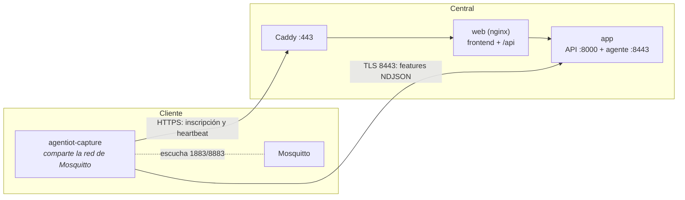

# Despliegue: local y producción

El sistema tiene dos partes que se despliegan por separado:

| Parte | Qué corre | Dónde | Archivo |
|---|---|---|---|
| **Central** | `app` (API + agente de detección), `web` (nginx + frontend), `redis`, `caddy`, `certgen` | tu servidor | `docker-compose.yml` |
| **Captura** | `agentiot-capture` (tshark → features → agente) | junto al Mosquitto de cada cliente | `Dockerfile.capture` |



La captura solo abre conexiones **de salida**: a la API para inscribirse y al
agente para enviar features. Nunca envía contraseñas, usuarios ni payloads MQTT.

Las direcciones que la captura usa **no se configuran en la captura**: se las
entrega la API al inscribirse, a partir de estas variables de la central:

| Variable de la central | Qué le dice a la captura | Local | Producción |
|---|---|---|---|
| `PUBLIC_API_URL` | dónde está la API (va en el comando de instalación) | `http://app:8000` | `https://api.tudominio.com` |
| `AGENT_PUBLIC_ENDPOINT` | dónde enviar las features | `tls://app:8443` | `tls://agent.tudominio.com:8443` |
| `AGENT_TLS_SERVER_NAME` | nombre que debe tener el certificado del agente | `app` | `agent.tudominio.com` |
| `AGENT_CA_PATH` | CA que se le entrega para verificar al agente | `/certs/agent/ca.crt` (certgen) | vacío (CA pública) |
| `CAPTURE_IMAGE` | imagen del comando de instalación | `agentiot-capture:latest` | `ghcr.io/<org>/agentiot-capture:latest` |

### Proxy nginx (`web`)

`web` construye el frontend (`frontend/Dockerfile`, multi-stage Node → nginx) y
lo sirve con `deploy/nginx/default.conf`:

- `/api/*` y `/health` → `app:8000` (timeout de lectura 330 s por los reportes de Ollama).
- `/assets/*` → caché de 1 año (archivos con hash de Vite).
- Cualquier otra ruta → `index.html` (SPA).

Caddy termina TLS y reenvía todo a `web:80`. Sin TLS, para pruebas locales:
`http://127.0.0.1:8081` (`WEB_PORT`). Tras cambiar la config:
`docker compose restart web`; tras cambiar el frontend: `docker compose up -d --build web`.

---

## 1. Local (todo en una máquina)

Los valores por defecto de `docker-compose.yml` ya sirven para esto: la central
anuncia `app:8000` y `app:8443`, que solo existen dentro de la red Docker
`agent_iot_default`. Por eso el Mosquitto de prueba se une a esa red, y la
captura, que comparte la red del Mosquitto, llega a la central.

### 1.1 Levantar la central

```bash
cp .env.example .env                 # copiar, no mover: .env.example está en git
openssl rand -hex 32                 # pegar en AUTH_JWT_SECRET del .env
docker compose up -d --build
docker compose ps                    # app debe quedar "healthy"
curl http://localhost:8000/health    # {"status":"ok"}
```

`certgen` crea en `certs/agent/` una CA local y el certificado del agente (SAN
`app`, `localhost`, `127.0.0.1`). Sin `AUTH_SMTP_HOST`, los correos de
verificación se escriben en el log de `app`.

### 1.2 Crear usuario y broker

```bash
API=http://localhost:8000/api/v1

curl -s -X POST $API/auth/register -H 'Content-Type: application/json' \
  -d '{"email":"yo@example.com","username":"yo","password":"una-clave-larga"}'

docker compose logs app | grep -i código     # el código de 6 dígitos

curl -s -X POST $API/auth/verify-email -H 'Content-Type: application/json' \
  -d '{"email":"yo@example.com","code":"123456"}'

TOKEN=$(curl -s -X POST $API/auth/login -H 'Content-Type: application/json' \
  -d '{"email":"yo@example.com","password":"una-clave-larga"}' \
  | python3 -c 'import sys,json; print(json.load(sys.stdin)["access_token"])')

curl -s -X POST $API/brokers -H "Authorization: Bearer $TOKEN" \
  -H 'Content-Type: application/json' \
  -d '{"name":"mosquitto","host":"mosquitto","port":1883}'
# → "enrollment_key": "ek_...", "install_command": "docker run ..."
```

La clave `ek_...` se muestra **una sola vez**. Si se pierde:
`POST $API/brokers/<id>/enrollment-key` genera otra (y revoca la anterior).

### 1.3 Mosquitto de prueba (el "cliente")

```bash
docker compose -f docker-compose.mosquitto.yml up -d
```

Levanta `mosquitto` en la red `agent_iot_default`, con MQTT 1883 sin
autenticación (expuesto en `127.0.0.1:1884` para publicar desde tu máquina).

### 1.4 Captura

```bash
docker build -f Dockerfile.capture -t agentiot-capture:latest .

docker run -d --name agentiot-capture --restart unless-stopped \
  --network container:mosquitto --cap-add NET_RAW \
  -v agentiot-capture-state:/state \
  -e ENROLL_KEY=ek_... \
  -e API_URL=http://app:8000 \
  agentiot-capture:latest

docker logs -f agentiot-capture
# [enroll] inscrito: broker=... sensor=...
# Capturing on 'eth0'
```

`--network container:<broker>` es la clave: la captura ve exactamente el tráfico
del broker. Su propio tráfico hacia el agente (8443) también pasa por `eth0`,
pero se ignora: solo se procesan tramas 1883/8883.

### 1.5 Generar tráfico con el simulador

El simulador viene en la imagen `agentiot-app`:

```bash
# Normal: el broker pasa a "connected", sin alertas
docker run --rm --network agent_iot_default agentiot-app:latest \
  python -m simulation --broker mosquitto --port 1883 \
  --ataque none --paquetes 500 --intervalo 0.1

# DoS: genera alertas
docker run --rm --network agent_iot_default agentiot-app:latest \
  python -m simulation --broker mosquitto --port 1883 \
  --ataque dos --dos-mode flood --force-attack --paquetes 30000
```

`--dos-mode flood` abre conexiones nuevas por ráfaga, como el dataset de
entrenamiento; `persistent` queda fuera de lo que el modelo vio y puede no
detectarse. `--dry-run` muestra qué publicaría sin conectar.

### 1.6 Comprobar

```bash
docker logs agentiot-capture | tail     # cada 60 s: [capture] socket {"sent": N, ...}
curl -s $API/brokers -H "Authorization: Bearer $TOKEN"            # "status": "connected"
curl -s "$API/alerts?broker_id=<id>" -H "Authorization: Bearer $TOKEN"
```

### 1.7 Limpiar

```bash
docker rm -f agentiot-capture && docker volume rm agentiot-capture-state
docker compose -f docker-compose.mosquitto.yml down
docker compose down            # -v borra también usuarios, alertas y evidencia
```

---

## 2. Producción

### 2.1 Requisitos

- Servidor Linux con Docker Engine 24+ y Compose v2.
- Dos nombres DNS apuntando a su IP pública: `api.tudominio.com` y
  `agent.tudominio.com`.
- Puertos de entrada: `80` y `443` (Caddy, Let's Encrypt) y `8443` (agente).
- Un registro de imágenes (por ejemplo GHCR) para publicar la captura.

### 2.2 Configurar la central (`.env`)

```env
AUTH_JWT_SECRET=<openssl rand -hex 32>
AUTH_COOKIE_SECURE=true
HTTP_PORT=80
HTTPS_PORT=443

# Caddy emite los certificados de ambos dominios con Let's Encrypt
API_DOMAIN=api.tudominio.com
AGENT_DOMAIN=agent.tudominio.com
ACME_EMAIL=ops@tudominio.com

# El agente usa el certificado que Caddy emitió para AGENT_DOMAIN
TLS_CERT=/caddy/caddy/certificates/acme-v02.api.letsencrypt.org-directory/agent.tudominio.com/agent.tudominio.com.crt
TLS_KEY=/caddy/caddy/certificates/acme-v02.api.letsencrypt.org-directory/agent.tudominio.com/agent.tudominio.com.key

# Lo que reciben las capturas al inscribirse
PUBLIC_API_URL=https://api.tudominio.com
AGENT_PUBLIC_ENDPOINT=tls://agent.tudominio.com:8443
AGENT_TLS_SERVER_NAME=agent.tudominio.com
AGENT_CA_PATH=                  # vacío: CA pública, las capturas usan las del sistema
CAPTURE_IMAGE=ghcr.io/<org>/agentiot-capture:latest

# Correo de verificación real
AUTH_SMTP_HOST=smtp.tudominio.com
AUTH_SMTP_PORT=587
AUTH_SMTP_USERNAME=...
AUTH_SMTP_PASSWORD=...
AUTH_SMTP_FROM=no-reply@tudominio.com
```

### 2.3 Levantar y publicar

```bash
docker compose up -d --build
curl https://api.tudominio.com/health                # {"status":"ok"}

docker build -f Dockerfile.capture -t ghcr.io/<org>/agentiot-capture:latest .
docker push ghcr.io/<org>/agentiot-capture:latest
```

En el primer arranque la API responde enseguida, pero el agente espera a que
Caddy obtenga el certificado de `AGENT_DOMAIN` (log de `app`:
`agente esperando certificados: ...`). Después, `CertificateReloader` recoge
las renovaciones sin reiniciar el agente.

### 2.4 Instalar la captura en un cliente

1. El cliente crea el broker en la web (**Agregar broker**) y copia el comando
   que aparece una sola vez.
2. En el servidor de su broker, cambia `mosquitto` por el nombre real del
   contenedor (`docker ps --format '{{.Names}}' | grep -i mosquitto`):

   ```bash
   docker run -d --name agentiot-capture --restart unless-stopped \
     --network container:<su-mosquitto> --cap-add NET_RAW \
     -v agentiot-capture-state:/state \
     -e ENROLL_KEY=ek_... \
     -e API_URL=https://api.tudominio.com \
     ghcr.io/<org>/agentiot-capture:latest
   ```

   Si Mosquitto no está en Docker, se usa la red del host y su interfaz:
   `--network host ... agentiot-capture:latest --iface ens5`.
3. En segundos el broker pasa de `pending` a `connected`.

El cliente solo necesita **salida** a `443` y `8443` hacia la central; no abre
puertos de entrada.

### 2.5 Sin dominio público (laboratorio expuesto)

Let's Encrypt no emite sin dominio. Alternativa:

```env
CADDY_EXTRA_GLOBAL=local_certs       # Caddy firma la API con su CA interna
AGENT_CA_PATH=/certs/agent/ca.crt    # el agente usa la CA de certgen y la API la entrega
AGENT_TLS_SERVER_NAME=app            # debe estar en el SAN del certificado de certgen
```

La captura necesita además la CA de Caddy para hablar con la API:
`-v ./caddy-root.crt:/certs/api-ca.crt:ro -e API_CA=/certs/api-ca.crt`.

---

## Problemas comunes

| Síntoma | Causa | Solución |
|---|---|---|
| `docker run`: *name already in use* | Quedó una captura anterior | `docker rm -f agentiot-capture` |
| `pull access denied for agentiot-capture` | La imagen no existe localmente | `docker build -f Dockerfile.capture -t agentiot-capture:latest .` |
| `API no disponible (... timed out / Name or service not known)` | La captura no llega a `API_URL` | Local: el broker debe estar en `agent_iot_default`. Prod: DNS y salida al 443 |
| `inscripción rechazada: HTTP 401` | Clave incorrecta, rotada o broker borrado | Generar una clave nueva |
| `CERTIFICATE_VERIFY_FAILED` hacia el agente | La CA cambió desde la inscripción (p. ej. `certgen` regeneró) o `AGENT_TLS_SERVER_NAME` no está en el SAN | Borrar `agentiot-capture-state` y reinscribir con clave nueva |
| `connected` pero `sent` en 0 | No hay tráfico MQTT o la captura no está en la red del broker | Revisar `--network container:<broker>`; correr el simulador |
| `sent` sube pero no hay alertas | Tráfico normal | Normal: solo alerta ante ataques (`--ataque dos`) |
| `Operation not permitted` al capturar | Falta la capacidad de captura | Agregar `--cap-add NET_RAW` |
| `sensor revocado, se detiene el envío` | Se rotó la clave o se reinstaló en otro equipo | Reinstalar con la clave nueva |
