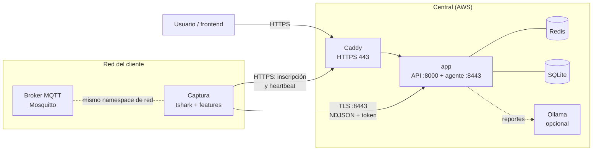
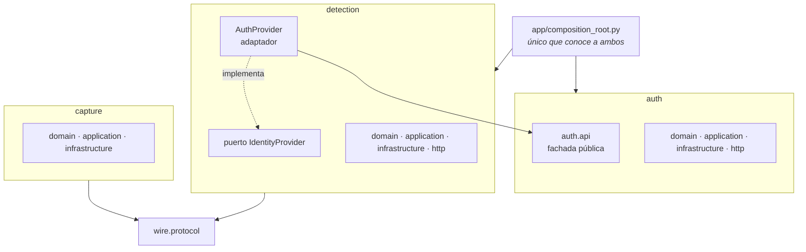
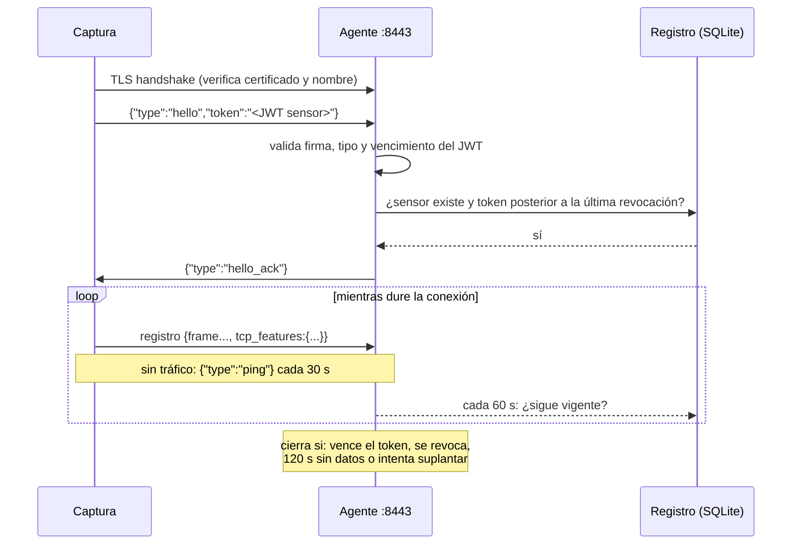
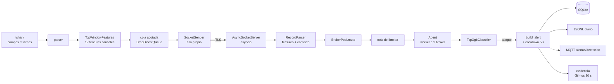
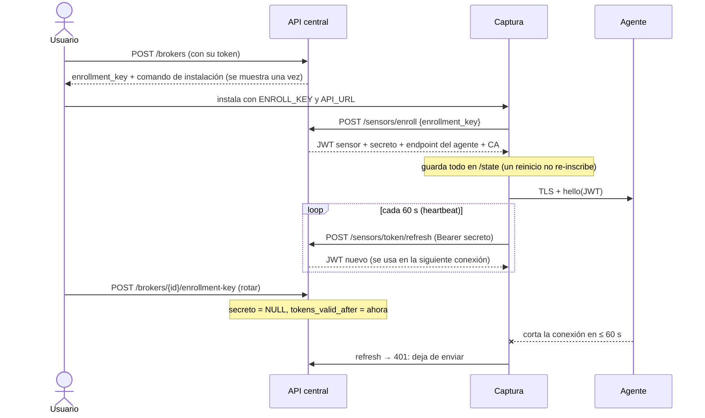

# Arquitectura de AgentIoT

Documento de referencia de cómo está construido el sistema: qué piezas hay,
cómo se hablan, por qué están hechas así y qué falta mejorar. Para instalarlo
ver [`instalacion.md`](instalacion.md) y [`../deploy/README.md`](../deploy/README.md).

## Índice

1. [Visión general](#1-visión-general)
2. [Despliegue: qué corre dónde](#2-despliegue-qué-corre-dónde)
3. [Organización del código](#3-organización-del-código)
4. [Arquitectura hexagonal por módulo](#4-arquitectura-hexagonal-por-módulo)
5. [Protocolo captura ↔ agente](#5-protocolo-captura--agente)
6. [Recorrido de un paquete](#6-recorrido-de-un-paquete)
7. [Concurrencia: colas y workers](#7-concurrencia-colas-y-workers)
8. [Seguridad](#8-seguridad)
9. [Inscripción y ciclo de vida del sensor](#9-inscripción-y-ciclo-de-vida-del-sensor)
10. [API REST](#10-api-rest)
11. [Datos y persistencia](#11-datos-y-persistencia)
12. [Configuración clave](#12-configuración-clave)
13. [Decisiones de diseño](#13-decisiones-de-diseño)
14. [Deuda técnica conocida](#14-deuda-técnica-conocida)
15. [Glosario](#15-glosario)

---

## 1. Visión general

AgentIoT detecta ataques DoS en tráfico MQTT real. Tiene dos aplicaciones:

| Aplicación | Dónde corre | Qué hace |
|---|---|---|
| **Central** (`src/app`) | Servidor propio (AWS) | API REST (usuarios, brokers, sensores, alertas, reportes) + **agente de detección** que recibe las capturas y corre el modelo. Un solo proceso. |
| **Captura** (`src/capture`) | Junto a cada broker MQTT del cliente | Escucha el tráfico con `tshark`, calcula 12 features TCP por paquete y las manda al agente. No toma decisiones. |



La división de trabajo es clara: **la captura mide, la central decide**. La
captura no tiene el modelo; solo calcula features y las envía. Así el modelo se
actualiza en un solo lugar y la imagen del cliente es pequeña (solo usa la
biblioteca estándar más `tshark`).

---

## 2. Despliegue: qué corre dónde

### Central — `docker-compose.yml`

| Servicio | Rol |
|---|---|
| `app` | Proceso Python único: FastAPI en `:8000` + agente TLS en `:8443` + limpieza de retención. |
| `caddy` | Entrada HTTPS pública (`:443`) hacia `app:8000`. Obtiene y renueva los certificados con Let's Encrypt, **también el del agente**. |
| `redis` | Códigos de verificación de correo (con caducidad). |
| `certgen` | Genera certificados autofirmados para laboratorio o cuando no hay dominio. |
| `ollama` | Opcional (`--profile ollama`): reportes en lenguaje natural. |

### Cliente — `docker-compose.capture.yml`

| Servicio | Rol |
|---|---|
| `capture` | Imagen `Dockerfile.capture`. Comparte la red del broker (`network_mode: container:mosquitto`) y necesita `NET_RAW` para capturar. Solo pide `ENROLL_KEY` y `API_URL`. |
| `mosquitto`, `certgen` | Solo en el perfil `lab` (broker de pruebas). |

### Dos entradas con TLS (y quién hace qué)

```text
                     ┌────────────────────── Central ───────────────────────┐
navegador ─HTTPS:443──→ Caddy ──HTTP──→ app:8000 (API)                       │
                     │    │  (Caddy cifra/descifra)                          │
                     │    └── emite y renueva certificados ──┐ (archivos)   │
                     │                                       ▼               │
captura ──TLS:8443──────────────────────────────────→ app:8443 (agente)     │
                     │       (cifra/descifra el código Python: ssl)          │
                     └───────────────────────────────────────────────────────┘
```

- **API**: Caddy hace todo el TLS; la app recibe HTTP plano dentro de Docker.
- **Agente**: la captura no habla HTTP sino un protocolo propio sobre un socket
  persistente, así que no pasa por Caddy. El TLS lo hace la app
  (`server_tls.py`), **reutilizando el certificado que Caddy emite** para
  `AGENT_DOMAIN`. Por eso el `Caddyfile` tiene un bloque que solo responde
  `"agent-iot"`: existe para que Caddy pida ese certificado.
  `CertificateReloader` detecta la renovación y recarga sin reiniciar.

---

## 3. Organización del código

```text
src/
  app/          composition root del monolito (auth + detection) y tareas de fondo
  auth/         usuarios, verificación de correo, sesiones JWT
  detection/    agente, alertas, brokers/sensores, reportes
  capture/      app independiente del cliente
  wire/         contrato compartido captura ↔ agente (solo stdlib)
simulation/     generador de tráfico de laboratorio (no es producción)
modelos_agente_tcp/  modelo XGBoost exportado + pipeline_config.json
tests/
```

### Monolito modular

`auth` y `detection` viven en el mismo proceso pero son módulos con fronteras:



Reglas que se cumplen hoy (verificadas por imports y por
`tests/test_module_boundaries.py`):

- `detection` solo usa `auth` a través de `auth.api` (`AuthApi`, `Identity`,
  `NotAuthenticated`) y siempre detrás de su puerto `IdentityProvider`. Los
  errores internos de `auth` se traducen y no cruzan la frontera.
- `capture` solo importa `wire` y la biblioteca estándar: se empaqueta sola.
- `wire` no depende de nada: es el contrato. Cambiarlo obliga a desplegar
  captura y agente juntos.

**Por qué monolito modular y no microservicios:** un solo proceso es más fácil
de desplegar y operar (un contenedor, una base), y las fronteras internas
permiten separar un módulo más adelante si hiciera falta, sin reescribirlo.

---

## 4. Arquitectura hexagonal por módulo

Cada módulo sigue *Ports and Adapters*:

```text
            ┌──────────────── infraestructura (adaptadores) ───────────────┐
            │  FastAPI · SQLite · Redis · JWT · Argon2 · tshark · sockets   │
            │      ┌──────────── aplicación (casos de uso) ────────┐        │
 entrada ──▶│      │  usan PUERTOS (interfaces) para hablar afuera  │        │──▶ salida
            │      │      ┌──────── dominio ────────┐               │        │
            │      │      │  reglas puras, sin I/O  │               │        │
            │      │      └─────────────────────────┘               │        │
            │      └─────────────────────────────────────────────────┘        │
            └───────────────────────────────────────────────────────────────┘
          Las dependencias apuntan siempre hacia adentro.
```

Ningún `domain/` ni `application/` importa frameworks ni librerías externas.

### auth

| Capa | Contenido |
|---|---|
| domain | `User` |
| application | Casos de uso: `Register`, `VerifyEmail`, `SendVerificationCode`, `ResendVerification`, `Login`, `RefreshSession`, `Logout`, `Authenticate`. Puertos: `UserRepository`, `PasswordHasher`, `TokenService`, `RefreshStore`, `VerificationCodeStore`, `MailSender`. |
| infrastructure | `UserRepositorySqlite`, `RefreshTokenStoreSQLite`, `VerificationCodeStoreRedis`, `PasswordHasherArgon2`, `PyJwtTokenService`, `MailSenderSMTP` / `MailSenderConsole`. |
| http / api | Routers FastAPI (`/api/v1/auth/*`) y la fachada `auth.api` para otros módulos. |

### detection

| Capa | Contenido |
|---|---|
| domain | `FrameContext`, `build_alert`, `AlertCooldown`, claves de flujo, estado del sensor. |
| application | `Agent` (detecta sobre un stream), `BrokerPool` (un worker por broker), `DetectionServer`, `IngestAlert`. Servicios: `SlidingWindows`, `EvidenceBuffer`. Puertos: `FeatureSource`, `Classifier`, `AlertSink`, `EvidenceSink`, `AlertRepository`, `IdentityProvider`. |
| infrastructure | `transport/` (servidor de sockets), `classifiers/TcpXgbClassifier`, `sinks/` (SQLite+JSONL, MQTT, evidencia), `repositories/` (SQLite), `sensor_tokens`, `auth_provider`. |
| http | Routers de brokers, sensores, alertas y reportes. |
| reporting | ETL de alertas, resúmenes y reportes con Ollama (ver deuda técnica). |

### capture

| Capa | Contenido |
|---|---|
| domain | `TcpWindowFeatures` (las 12 features, incremental), ventanas, LRU, exclusión del stream de alertas, `wire_record`. |
| application | `StreamFeatures`, `EnrollSensor`, `RefreshSensorToken`. Puertos: `PacketSource`, `RecordSender`, `EnrollmentApi`, `SensorStateStore`. |
| infrastructure | `tshark/` (proceso y parser), `transport/` (`SocketSender`, conectores Unix/TLS, `TokenAuth`), `enrollment/` (cliente HTTP, estado en disco). |

---

## 5. Protocolo captura ↔ agente

Definido en `src/wire/protocol.py`. Es **NDJSON**: un objeto JSON por línea.

### Endpoints

| Esquema | Uso | Autenticación |
|---|---|---|
| `unix:///capture/features.sock` (o una ruta) | Desarrollo: misma máquina | Ninguna (permisos del archivo, `0660`) |
| `tls://host:8443` | Producción: por internet | TLS (servidor) + token de sensor |

### Conversación en TLS



### Registro

Cada línea lleva los campos de `RECORD_FIELDS` (`frame.time_epoch`, `ip.src`,
`tcp.stream`, `mqtt.clientid`, `mqtt.topic`, …) y `tcp_features` con las 12
columnas de `TCP_FEATURE_COLUMNS`, **en el mismo orden con el que se entrenó
el modelo**. Nunca viajan contraseñas, usuarios ni payloads MQTT.

En TLS, `tenant_id`, `broker_id` y `sensor_id` los pone el agente a partir del
token (`SensorIdentity.bind`); si un registro trae otros, la conexión se cierra.

---

## 6. Recorrido de un paquete



1. **Captura**: `tshark` solo extrae los campos necesarios. `StreamFeatures`
   descarta el tráfico del propio publicador de alertas (para no contaminar las
   ventanas) y `TcpWindowFeatures` calcula las features sobre ventanas de 5 s.
2. **Envío**: el registro va a una cola con tope; si el agente no responde, se
   descartan los más viejos en lugar de bloquear a `tshark`.
3. **Recepción**: el servidor asyncio autentica, lee líneas y arma un `Frame`
   (features + `FrameContext` con cliente, IP, tópico; el `client_id` y el
   tópico se recuerdan por conexión TCP porque no todos los paquetes los traen).
4. **Detección**: el worker del broker clasifica cada paquete por flujo. Si es
   `ataque`, se arma la alerta con el **cliente** como responsable (no el
   broker), con cooldown para no repetir la misma alerta.
5. **Salida**: `IngestAlert` guarda en SQLite y en el JSONL diario (el mismo
   caso de uso que usa `POST /alerts`). Opcionalmente se publica por MQTT y se
   escribe la evidencia de los últimos 30 s.

---

## 7. Concurrencia: colas y workers

```text
sensor A ─┐                         ┌─ cola A (10k) ─→ worker A ─→ modelo ─→ alertas
sensor B ─┼─→ servidor asyncio ─────┼─ cola B (10k) ─→ worker B ─→ modelo ─→ alertas
sensor C ─┘   (un hilo, miles       └─ cola C (10k) ─→ worker C ─→ modelo ─→ alertas
              de conexiones)
```

| Pieza | Hilo | Por qué |
|---|---|---|
| `AsyncSocketServer` | 1 hilo con event loop | Atiende miles de conexiones sin un hilo por conexión; solo lee y enruta, nunca espera al modelo. |
| `BrokerWorker` | 1 hilo por (tenant, broker), máx. 256 | Aísla clientes: un broker atacado llena **su** cola y no frena a los demás. Cada uno tiene su propio estado de ventanas. |
| Colas | — | Acotadas (10.000). Si se llenan, se descarta en vez de crecer sin límite en memoria. |
| Reaper | 1 hilo | Cierra workers de brokers sin tráfico por 10 min. |
| `SocketSender` (captura) | 1 hilo | Separa la lectura de `tshark` del envío por red. |
| `CertificateReloader`, `RetentionLoop`, `AgentRunner` | 1 hilo c/u | Tareas de fondo que no deben bloquear la API. |

---

## 8. Seguridad

### Capas

| Amenaza | Defensa |
|---|---|
| Leer o alterar el tráfico captura → central | TLS con verificación estricta en el cliente (`CERT_REQUIRED`, `check_hostname`). |
| Captura engañada por un servidor falso | El cliente valida el certificado contra la CA recibida al inscribirse o las CA del sistema. |
| Sensor desconocido enviando datos | `hello` con JWT de sensor firmado (`type: sensor`), obligatorio en TLS. |
| Sensor revocado o reinstalado que sigue enviando | El agente consulta el registro en el `hello` y cada 60 s (`tokens_valid_after`). |
| Un cliente haciéndose pasar por otro | La identidad sale del token; si un registro trae otra, se cierra la conexión. |
| Agotar conexiones | Tope global (10.000), tope por sensor (4) y cierre tras 120 s sin datos. |
| Conexiones colgadas en el arranque | Timeout del handshake TLS (10 s) y del `hello` (5 s). |
| Líneas gigantes | Límite de 64 KiB por línea. |
| Contraseñas de usuarios | Argon2. |
| Tokens de usuario | JWT de acceso (15 min) y refresh (7 días) revocables; el campo `type` impide usar un token de sensor como de usuario y viceversa. |

### Tokens

| Token | Quién lo usa | Vida por defecto | Cómo se revoca |
|---|---|---|---|
| Acceso de usuario | Frontend → API | 15 min (`AUTH_ACCESS_TTL_MINUTES`) | Vence solo |
| Refresh de usuario | Frontend → `/auth/refresh` | 7 días (`AUTH_REFRESH_TTL_MINUTES`) | `logout` (tabla de refresh) |
| Clave de inscripción | Captura, una vez | Hasta que se rota | `POST /brokers/{id}/enrollment-key` |
| Secreto del sensor | Captura → `/sensors/token/refresh` | Indefinido | Rotar la clave o reinstalar |
| JWT de sensor | Captura → agente (`hello`) | 24 h (`SENSOR_TOKEN_TTL_MINUTES`) | `tokens_valid_after` en el registro |

---

## 9. Inscripción y ciclo de vida del sensor



Estados que ve el usuario (`sensor_status`): `pending` (nunca se conectó),
`connected` (heartbeat reciente) y `offline` (sin heartbeat o revocado).

---

## 10. API REST

Base: `/api/v1`. Salud: `GET /health`.

| Método y ruta | Auth | Para qué |
|---|---|---|
| `POST /auth/register` | — | Crear usuario y enviar código. |
| `POST /auth/verify-email` | — | Confirmar el código. |
| `POST /auth/resend-verification` | — | Reenviar el código. |
| `POST /auth/login` | — | Obtener tokens de acceso y refresh. |
| `POST /auth/refresh` | refresh (cookie) | Renovar la sesión. |
| `POST /auth/logout` | refresh (cookie) | Revocar la sesión y borrar la cookie. |
| `GET /auth/me` | usuario | Datos del usuario. |
| `POST /brokers` | usuario | Registrar broker; devuelve la clave de inscripción. |
| `GET /brokers`, `GET /brokers/{id}` | usuario | Listar y ver estado. |
| `POST /brokers/{id}/enrollment-key` | usuario | Rotar la clave (revoca la captura instalada). |
| `DELETE /brokers/{id}` | usuario | Borrar broker y sus sensores (las alertas se conservan). |
| `POST/GET /brokers/{id}/sensors` | usuario | Crear y listar sensores. |
| `POST /sensors/enroll` | clave de inscripción | Inscribir la captura. |
| `POST /sensors/token/refresh` | secreto del sensor | Heartbeat y token nuevo. |
| `POST /sensors/{id}/token` | usuario | Emitir un token de sensor a mano. |
| `POST /alerts` | JWT de sensor | Ingresar una alerta desde fuera (el agente guarda directo, sin HTTP). |
| `GET /alerts`, `GET /alerts/{id}` | usuario | Consultar alertas del tenant. |
| `GET /reports/analytics` | usuario | Resumen analítico en JSON. |
| `POST /reports` | usuario | Reporte en lenguaje natural (Ollama). |

Cada usuario es un **tenant**: solo ve sus brokers, sensores y alertas.

---

## 11. Datos y persistencia

| Dato | Dónde | Notas |
|---|---|---|
| Usuarios y refresh tokens | SQLite `/data/auth.db` | |
| Códigos de verificación | Redis | Caducan solos. |
| Brokers, sensores, alertas | SQLite `/data/detection.db` | WAL; las columnas nuevas se agregan solas (`MIGRATIONS`). |
| Alertas (journal) | `/alerts/*.jsonl` (uno por día) | Retención `ALERT_RETENTION_DAYS` (0 = sin límite). |
| Evidencia | `/evidence/` | Últimos 30 s de frames por alerta, máx. 500 MB; retención `EVIDENCE_RETENTION_DAYS` (30). |
| Reporte | `/processed/report.json` | Generado por `detection.reporting`. |
| Estado de la captura | `/state` (volumen del cliente) | Identidad, secreto y CA del agente. |
| Modelo | `modelos_agente_tcp/` (dentro de la imagen) | `xgb_tcp.ubj` + `pipeline_config.json` + `le_target.joblib`. |

---

## 12. Configuración clave

### Central (`.env`)

| Variable | Para qué |
|---|---|
| `AUTH_JWT_SECRET` | **Obligatoria.** Firma los JWT de usuario y de sensor. |
| `API_DOMAIN`, `AGENT_DOMAIN`, `ACME_EMAIL` | Dominios públicos para Caddy y Let's Encrypt. |
| `TLS_CERT`, `TLS_KEY` | Certificado del agente (el de Caddy en producción; ver `deploy/README.md`). |
| `CAPTURE_ENDPOINT` | Dónde escucha el agente (`tls://0.0.0.0:8443`). Si no está, no arranca el agente. |
| `AGENT_PUBLIC_ENDPOINT`, `AGENT_TLS_SERVER_NAME`, `PUBLIC_API_URL` | Lo que recibe la captura al inscribirse. |
| `SENSOR_TOKEN_TTL_MINUTES`, `SENSOR_REFRESH_SECONDS` | Vida del JWT de sensor y frecuencia del heartbeat. |
| `ALERT_MQTT_*` | Publicar alertas por MQTT (opcional). |
| `OLLAMA_BASE_URL`, `OLLAMA_MODEL` | Reportes en lenguaje natural. |

### Captura

| Variable | Para qué |
|---|---|
| `ENROLL_KEY`, `API_URL` | Lo único obligatorio: el resto llega con la inscripción. |
| `CAPTURE_ENDPOINT`, `TLS_CA`, `SENSOR_TOKEN` | Para forzar valores a mano (laboratorio o proxy). |

### Constantes del transporte

| Constante | Valor | Archivo |
|---|---|---|
| `KEEPALIVE_SECONDS` | 30 s | `wire/protocol.py` |
| `IDLE_TIMEOUT_SECONDS` | 120 s | `wire/protocol.py` |
| `RECHECK_SECONDS` | 60 s | `sensor_connection.py` |
| `MAX_CONNECTIONS` / por sensor | 10.000 / 4 | `async_socket_server.py` |
| `HELLO_TIMEOUT` / handshake TLS | 5 s / 10 s | `sensor_auth.py` / `tls_listener.py` |
| `READ_LIMIT` | 64 KiB por línea | `async_socket_server.py` |

---

## 13. Decisiones de diseño

| Decisión | Alternativa descartada | Por qué |
|---|---|---|
| Monolito modular | Microservicios | Un equipo pequeño; un solo despliegue. Las fronteras permiten separar después. |
| Agente dentro del proceso de la API | Servicio aparte | Guarda alertas con el mismo `IngestAlert`, sin HTTP ni tokens internos. |
| Features en la captura, modelo en la central | Modelo en el cliente | Imagen del cliente liviana y sin ML; el modelo se actualiza en un lugar. |
| Socket TCP + NDJSON propio | HTTP/WebSocket por Caddy | Flujo continuo de muchos registros pequeños con poco overhead. A cambio, el TLS del 8443 lo hace la app. |
| Unix en local, TLS en producción | TLS siempre | En la misma máquina no hay a quién cifrar; simplifica el laboratorio. |
| Token en el `hello` en vez de mTLS | Certificado por sensor | Emitir y revocar tokens es más simple que gestionar una PKI de clientes. |
| Un worker por broker | Pool compartido | Aislamiento entre clientes y estado de ventanas por broker. |
| Colas acotadas que descartan | Colas ilimitadas | Ante un ataque, perder datos es preferible a que se acabe la memoria. |
| SQLite | PostgreSQL | Suficiente para un nodo; sin servicio extra. Es lo primero a cambiar si se escala a varias instancias. |

---

## 14. Deuda técnica conocida

| # | Tema | Detalle |
|---|---|---|
| H1 | Lógica en la capa HTTP | Inscripción y gestión de brokers/sensores llaman a SQLite desde los routers; deberían ser casos de uso en `detection/application`. |
| H2 | `reporting/` fuera del hexágono | Usa `pandas` y llama a Ollama directo; falta un puerto de reportes/LLM. |
| H3 | Adaptador → adaptador | `http/security.py` importa `TokenError` de `infrastructure.sensor_tokens`. |
| S3 | Unix sin auth en producción | Nada impide configurar `unix://` en producción; convendría rechazarlo o avisar. |
| S4 | `TLS_CA` del servidor | Se carga pero no se usa (no hay mTLS). |
| — | Secreto JWT compartido | Usuarios y sensores firman con `AUTH_JWT_SECRET`; separarlos reduce el impacto de una filtración. |
| — | Escala horizontal | SQLite y el estado en memoria del agente atan la central a una instancia. |

---

## 15. Glosario

| Término | Significado |
|---|---|
| **Tenant** | Un usuario/cliente; sus datos están aislados del resto. |
| **Broker** | Un servidor MQTT del cliente que se quiere proteger. |
| **Sensor / captura** | La instalación de `capture` junto a un broker. |
| **Agente** | El receptor en la central que clasifica y genera alertas. |
| **Feature** | Número calculado del tráfico que el modelo usa para decidir. |
| **NDJSON** | Un JSON por línea. |
| **TLS** | Canal cifrado + certificado que prueba la identidad del servidor. |
| **Puerto / adaptador** | Interfaz que define el núcleo / implementación concreta en infraestructura. |
| **Composition root** | El único lugar donde se crean y conectan las piezas concretas. |
| **Cola acotada** | Bandeja con tamaño máximo entre quien recibe y quien procesa. |
| **Worker** | Hilo dedicado a procesar la cola de un broker. |
| **Heartbeat** | Señal periódica de la captura a la API para indicar que sigue viva. |
